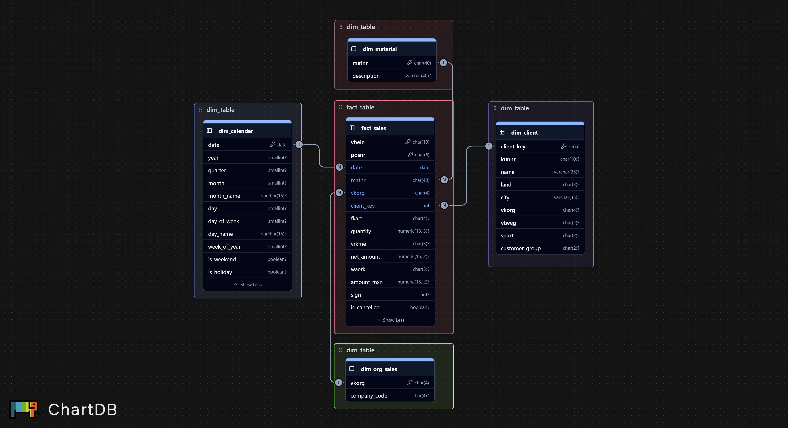

# SAP SD — Sales Star Schema

Hands-on dimensional modeling project built on **SAP SD (Sales & Distribution)** data.
It simulates SAP billing tables in PostgreSQL with synthetic data and transforms them into a **Kimball star schema** ready for Power BI.

> All data is 100% fictitious, generated with Python and Faker. It contains no information from any real company.

## Architecture

```
generate_data.py  ──►  sap_raw  ──►  transform_dw.sql  ──►  dw  ──►  Power BI
 (simulates SAP)     (faithful copy   (business rules)     (star
                      of the source)                        schema)
```

| Layer | Schema | Contents |
|---|---|---|
| Source | `sap_raw` | SAP tables with their original names and types, untransformed. |
| Analytics | `dw` | Star schema with business-friendly names and derived columns. |

**Principle:** `sap_raw` mirrors the source as-is. Every business rule (sign, currency, cancellations) lives in the transformation, so `dw` can be dropped and rebuilt without touching the source data.

## `sap_raw` layer: simulated SAP tables


| Table | Description | Primary key |
|---|---|---|
| `tvko` | Sales organizations → company code | `vkorg` |
| `kna1` | Customer master (general data) | `kunnr` |
| `knvv` | Customer per sales area | `kunnr, vkorg, vtweg, spart` |
| `mara` | Material master | `matnr` |
| `makt` | Material descriptions by language | `matnr, spras` |
| `vbrk` | Billing document header | `vbeln` |
| `vbrp` | Billing document items | `vbeln, posnr` |

### Key SAP fields

| Field | Meaning |
|---|---|
| `vbtyp` | Document category: `M` = invoice, `O` = credit memo |
| `fkart` | Billing type: `F2` = invoice, `G2` = credit memo |
| `fksto` | `X` = cancelled invoice |
| `netwr` | Net value, **always positive**; the sign comes from `vbtyp` |
| `waerk` | Document currency (`MXN`, `USD`) |
| `fkimg` / `vrkme` | Billed quantity / sales unit |
| `kunag` | Sold-to party (called `kunnr` in `knvv`/`kna1`) |
| `vkorg` / `vtweg` / `spart` | Sales area: sales organization / distribution channel / division |
| `kdgrp` | Customer group |
| `spras` | Language (`S` = Spanish, `E` = English) |

## `dw` layer: star schema



**Grain of `fact_sales`:** one row per **billing item** (`vbrp`).

| Table | Source | Key |
|---|---|---|
| `fact_sales` | `vbrp` + `vbrk` | `vbeln, posnr` (degenerate dimension) |
| `dim_client` | `knvv` + `kna1` | `client_key` (surrogate) · `UNIQUE (kunnr, vkorg, vtweg, spart)` |
| `dim_material` | `makt` (only `spras = 'E'`, English descriptions) | `matnr` |
| `dim_org_sales` | `tvko` | `vkorg` |
| `dim_calendar` | `generate_series` 2025-2026 (includes `year_month` for monthly axes) | `date` |

### Design decisions

- **Surrogate key in `dim_client`.** A customer appears once per sales area, so its natural key has 4 columns. `client_key` lets the fact join on a single column (Power BI does not support multi-column relationships). The natural key is kept as a `UNIQUE` constraint to prevent duplicates and to look up `client_key` when loading the fact.
- **Unsigned amounts + `sign` column.** `net_amount` and `amount_mxn` are stored as positive values, as in SAP; `sign` (1 / -1) says whether the row subtracts. The measure applies the sign once:
  ```dax
  Net Sales MXN =
  SUMX (
      FILTER ( fact_sales, NOT fact_sales[is_cancelled] ),
      fact_sales[amount_mxn] * fact_sales[sign]
  )
  ```
- **Currency and unit are attributes, not measures.** `waerk` and `vrkme` give context to amounts and quantities; they are never summed.
- **Business labels for codes.** `channel_name`, `customer_group_name` and `sales_org_name` translate SAP codes (`10`, `01`, `MX01`) into readable text in the transformation, with `'Unknown'` as a fallback for new codes.
- **Conversion to MXN** uses a fixed exchange rate of 18 (a simplification for this exercise).
- **Calendar** includes Mexico's official holidays for 2025-2026 (`is_holiday`).
- **Full refresh loads.** `transform_dw.sql` truncates every `dw` table and reloads it inside a single transaction, so it can run any number of times without duplicates, and a failure rolls back to the previous data.

## Files

| File | Purpose |
|---|---|
| `creation_schema_sap_tables.sql` | Creates the `sap_raw` schema and its 7 tables with keys and FKs. |
| `generate_data.py` | Generates synthetic data (10 customers, 30 materials, 500 billing documents) and loads it into `sap_raw`. |
| `creation_schema_star_tables.sql` | Creates the `dw` schema with the dimensions and the fact table. |
| `transform_dw.sql` | Populates `dw` from `sap_raw` (dimensions first, fact last) in a single transaction. |
| `SAP SD PBI/` | Power BI project (`.pbip`) with the report. |
| `.env.example` | Template for the database connection string. |
| `erd_sap_sales_distribution.png` | Diagram of the SAP tables. |
| `star_schema_sap.png` | Diagram of the star schema. |

## How to run it

**Requirements:** PostgreSQL and Python 3 with `pandas`, `sqlalchemy`, `psycopg2`, `faker` and `python-dotenv`.

```powershell
pip install pandas sqlalchemy psycopg2-binary faker python-dotenv
```

1. Copy `.env.example` to `.env` and set the real connection string (`.env` is in `.gitignore`).
2. Create the source tables: run `creation_schema_sap_tables.sql`.
3. Generate the data in `sap_raw`:
   ```powershell
   python generate_data.py
   ```
4. Create the star schema: run `creation_schema_star_tables.sql`.
5. Transform: run `transform_dw.sql`. It performs a **full refresh**, so it is safe to run repeatedly.
6. Open `SAP SD PBI/SAP_SD.pbip` in Power BI Desktop and refresh.
7. Verify:
   ```sql
   SELECT 'calendar' AS table_name, COUNT(*) FROM dw.dim_calendar
   UNION ALL SELECT 'material',  COUNT(*) FROM dw.dim_material
   UNION ALL SELECT 'org_sales', COUNT(*) FROM dw.dim_org_sales
   UNION ALL SELECT 'client',    COUNT(*) FROM dw.dim_client
   UNION ALL SELECT 'fact',      COUNT(*) FROM dw.fact_sales;
   ```

To regenerate the source data from scratch, empty `sap_raw` first (the generator uses `ON CONFLICT DO NOTHING`, so it will not overwrite existing rows), then repeat steps 3 and 5:

```sql
TRUNCATE sap_raw.vbrp, sap_raw.vbrk, sap_raw.knvv, sap_raw.makt,
         sap_raw.mara, sap_raw.kna1, sap_raw.tvko;
```

## Status

- [x] SAP tables in `sap_raw` and data generator
- [x] Star schema design
- [x] Dimensions and `fact_sales` in `transform_dw.sql` (full refresh)
- [x] Business labels for channel, customer group and sales organization
- [x] Generator realism fixes: only `F2` invoices get cancelled, USD prices, fixed end date
- [x] Credentials in `.env`
- [x] Power BI report (2 pages)
- [ ] Credit memos linked to a previous invoice (today they are independent, so a month can show a return rate above 100%)
- [ ] Migrate the transformation to dbt
