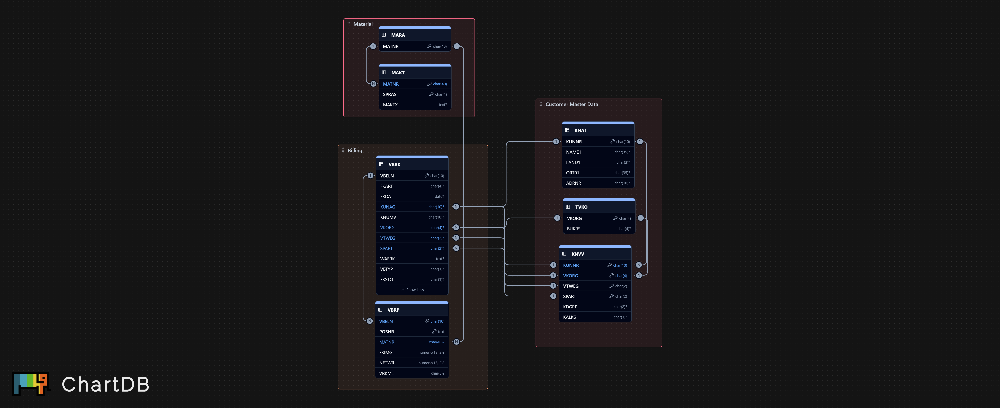

# SAP SD — Modelo estrella de ventas

Proyecto práctico de modelado dimensional sobre datos de **SAP SD (Sales & Distribution)**.
Simula las tablas de facturación de SAP en PostgreSQL con datos sintéticos y las transforma en un **modelo estrella (Kimball)** listo para Power BI.

> Los datos son 100% ficticios, generados con Python y Faker. No contiene información de ninguna empresa real.

## Arquitectura

```
generate_data.py  ──►  sap_raw  ──►  transform_dw.sql  ──►  dw  ──►  Power BI
 (simula SAP)        (copia fiel     (reglas de negocio)    (modelo
                      de la fuente)                          estrella)
```

| Capa | Schema | Contenido |
|---|---|---|
| Fuente | `sap_raw` | Tablas SAP con sus nombres y tipos originales, sin transformar. |
| Analítica | `dw` | Modelo estrella con nombres de negocio y columnas calculadas. |

**Principio:** `sap_raw` refleja la fuente tal cual. Toda regla de negocio (signo, moneda, cancelaciones) vive en la transformación, así `dw` se puede borrar y reconstruir sin tocar los datos de origen.

## Capa `sap_raw`: tablas SAP simuladas



| Tabla | Descripción | Llave primaria |
|---|---|---|
| `tvko` | Organizaciones de ventas → sociedad | `vkorg` |
| `kna1` | Maestro de clientes (datos generales) | `kunnr` |
| `knvv` | Cliente por área de ventas | `kunnr, vkorg, vtweg, spart` |
| `mara` | Maestro de materiales | `matnr` |
| `makt` | Descripciones de material por idioma | `matnr, spras` |
| `vbrk` | Encabezado de factura | `vbeln` |
| `vbrp` | Posiciones de factura | `vbeln, posnr` |

### Campos SAP clave

| Campo | Significado |
|---|---|
| `vbtyp` | Categoría del documento: `M` = factura, `O` = nota de crédito |
| `fkart` | Clase de factura: `F2` = factura, `G2` = nota de crédito |
| `fksto` | `X` = factura cancelada |
| `netwr` | Valor neto, **siempre positivo**; el signo se deduce de `vbtyp` |
| `waerk` | Moneda del documento (`MXN`, `USD`) |
| `fkimg` / `vrkme` | Cantidad facturada / unidad de venta |
| `kunag` | Cliente solicitante (en `knvv`/`kna1` se llama `kunnr`) |
| `vkorg` / `vtweg` / `spart` | Área de ventas: organización / canal / sector |
| `kdgrp` | Grupo de clientes |
| `spras` | Idioma (`S` = español, `E` = inglés) |

## Capa `dw`: modelo estrella


**Grano de `fact_sales`:** una fila por **línea de factura** (`vbrp`).

| Tabla | Origen | Llave |
|---|---|---|
| `fact_sales` | `vbrp` + `vbrk` | `vbeln, posnr` (dimensión degenerada) |
| `dim_client` | `knvv` + `kna1` | `client_key` (sustituta) · `UNIQUE (kunnr, vkorg, vtweg, spart)` |
| `dim_material` | `makt` (solo `spras = 'S'`) | `matnr` |
| `dim_org_sales` | `tvko` | `vkorg` |
| `dim_calendar` | `generate_series` 2025-2026 | `date` |

### Decisiones de diseño

- **Llave sustituta en `dim_client`.** Un cliente aparece una vez por área de ventas, así que su llave natural tiene 4 columnas. `client_key` permite unir el fact con una sola columna (Power BI no admite relaciones de varias columnas). La llave natural se conserva como `UNIQUE` para evitar duplicados y para buscar el `client_key` al cargar el fact.
- **Montos sin signo + columna `sign`.** `net_amount` y `amount_mxn` se guardan positivos como en SAP; `sign` (1 / -1) indica si resta. La medida aplica el signo una sola vez:
  ```dax
  Ventas Netas MXN =
  SUMX (
      FILTER ( fact_sales, NOT fact_sales[is_cancelled] ),
      fact_sales[amount_mxn] * fact_sales[sign]
  )
  ```
- **Moneda y unidad son atributos, no medidas.** `waerk` y `vrkme` acompañan a los montos y cantidades para interpretarlos; no se suman.
- **Conversión a MXN** con tipo de cambio fijo de 18 (simplificación del ejercicio).
- **Calendario** con festivos oficiales de México 2025-2026 (`is_holiday`).
- **Cargas idempotentes:** todos los `INSERT` usan `ON CONFLICT DO NOTHING`, así el proceso puede correr varias veces sin duplicar filas.

## Archivos

| Archivo | Qué hace |
|---|---|
| `creation_schema_sap_tables.sql` | Crea el schema `sap_raw` y sus 7 tablas con llaves y FKs. |
| `generate_data.py` | Genera datos sintéticos (10 clientes, 30 materiales, 500 facturas) y los carga a `sap_raw`. |
| `creation_schema_star_tables.sql` | Crea el schema `dw` con las dimensiones y el fact. |
| `transform_dw.sql` | Llena `dw` desde `sap_raw` (dimensiones primero, fact al final) en una transacción. |
| `erd_sap_sales_distribution.png` | Diagrama de las tablas SAP. |
| `star_schema_sap.png` | Diagrama del modelo estrella. |

## Cómo ejecutarlo

**Requisitos:** PostgreSQL y Python 3 con `pandas`, `sqlalchemy`, `psycopg2` y `faker`.

```powershell
pip install pandas sqlalchemy psycopg2-binary faker
```

1. Crear las tablas fuente: correr `creation_schema_sap_tables.sql`.
2. Ajustar la cadena de conexión en `generate_data.py` y ejecutarlo:
   ```powershell
   python generate_data.py
   ```
3. Crear el modelo estrella: correr `creation_schema_star_tables.sql`.
4. Transformar: correr `transform_dw.sql`.
5. Verificar:
   ```sql
   SELECT 'calendar' AS tabla, COUNT(*) FROM dw.dim_calendar
   UNION ALL SELECT 'material',  COUNT(*) FROM dw.dim_material
   UNION ALL SELECT 'org_sales', COUNT(*) FROM dw.dim_org_sales
   UNION ALL SELECT 'client',    COUNT(*) FROM dw.dim_client
   UNION ALL SELECT 'fact',      COUNT(*) FROM dw.fact_sales;
   ```

Para regenerar los datos desde cero:

```sql
TRUNCATE sap_raw.vbrp, sap_raw.vbrk, sap_raw.knvv, sap_raw.makt,
         sap_raw.mara, sap_raw.kna1, sap_raw.tvko;
```

## Estado

- [x] Tablas SAP en `sap_raw` y generador de datos
- [x] Diseño del modelo estrella
- [x] Dimensiones en `transform_dw.sql`
- [ ] Carga de `fact_sales`
- [ ] Mover las dimensiones fuera de `generate_data.py` (ya están en `transform_dw.sql`)
- [ ] Ajustes de realismo en el generador: cancelar solo facturas `F2`, precios en USD, `kalks` como texto
- [ ] Mover credenciales a un archivo `.env`
- [ ] Reporte en Power BI
- [ ] Migrar la transformación a dbt
